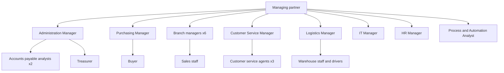

# Phase 1. The fictional company

**Project:** AI Governance in Operations: KPIs, ROI and process control with Power BI
**Case:** Cumbre Andina Building Supplies (fictional company)
**Version:** 1.1, 03/11/2026 (approved adjustment: personal data vault, pseudonymization, local model and tax authority QR code)

> Everything below is invented. The numbers in this document are **case parameters**: they are used to generate the synthetic data in Phase 4. They are not results or data from any real company.

---

## 1. Identity

- **Name:** Cumbre Andina Building Supplies (fictional company)
- **Industry:** distribution and retail of construction materials, as a building materials distributor.
- **Customers:** individuals doing renovations, small contractors and construction companies.
- **Location:** the capital metropolitan area (no specific address).
- **Physical structure:** 1 head office with a main warehouse and 6 branches.
- **Staff:** 85 people.

## 2. Departments and roles

| Department | Roles | Count |
|---|---|---|
| Management | Managing partner | 1 |
| Administration and Finance | Administration Manager, accounts payable analysts, treasurer | 1 + 2 + 1 |
| Purchasing | Purchasing Manager, buyer | 1 + 1 |
| Sales | Branch managers, sales staff | 6 + 30 |
| Customer Service | Customer Service Manager, agents | 1 + 3 |
| Logistics and warehouse | Logistics Manager, warehouse staff, drivers | 1 + 20 + 12 |
| IT | IT Manager | 1 |
| Human Resources | HR Manager | 1 |
| Processes | Process and Automation Analyst | 1 |

The **Process and Automation Analyst** is the role from which the project is told.

## 3. Systems in use

| System | Use |
|---|---|
| Management ERP (generic) | Stock, sales, purchasing, accounts payable |
| Microsoft 365 (Outlook, Excel, SharePoint, Teams) | Email, spreadsheets, documents, internal communication |
| WhatsApp Business | Customer service |
| Online banking | Payments to suppliers |
| n8n | Orchestration of automations (introduced by the project) |
| Postgres | Execution log, audit, personal data vault and project data |
| Power BI | Governance dashboard, only with pseudonymized or aggregated data (introduced by the project) |
| Own server with Ollama | Local AI model for the steps that touch unmasked personal data (introduced by the project) |

## 4. Monthly volumes (case parameters)

### Supplier invoices (P1)
- Active suppliers: 120.
- Invoices received per month: 900.
- Arrival channel: 70% PDF by email, 20% scanned paper, 10% download from the supplier portal.
- Document type: invoices, credit notes and debit notes.

### Customer complaints (P2)
- Complaints per month: 350.
- Channel: 50% WhatsApp, 30% email, 20% at the branch.
- Categories: delayed delivery, damaged material, missing items in the delivery, billing error, branch service, other.
- Committed deadline (SLA): first response within 24 business hours, resolution within 5 business days.

## 5. How it works today (AS-IS, summary)

**P1. Supplier invoices**
1. Invoices arrive in a shared Administration mailbox.
2. An analyst opens them one by one and checks tax ID, date, amounts and purchase order.
3. They enter the data by hand into the ERP.
4. If something does not match, they write to Purchasing or to the supplier and the invoice is put on hold.
5. The treasurer prepares the week's payments from the ERP.

Known problems: duplicate entry, invoices lost in the mailbox, approval delays, typing errors and no systematic control of bank account changes.

**P2. Customer complaints**
1. Complaints come in through WhatsApp, email or at the branch.
2. A Customer Service agent reads them, records them in a spreadsheet and routes them by email or WhatsApp to the department they think is responsible.
3. Each department responds when it can. There is no centralized deadline tracking.

Known problems: unanswered complaints, routing to the wrong department, the customer complains twice about the same issue, and there is no data to know which branch or category generates the most complaints.

## 6. Organization chart

## 7. Data map

| Data | Originates in | Travels through | Stored in | Entered by | Used by | Personal or sensitive data? |
|---|---|---|---|---|---|---|
| Supplier invoice (PDF) | Supplier | Email | Mailbox and SharePoint | Supplier | Accounts payable | No (commercial data) |
| Supplier tax ID and company name | Supplier | Invoice and tax authority QR code | ERP | Accounts payable | Purchasing, Treasury | No, except for self-employed suppliers: their tax ID identifies a person |
| Supplier bank account (bank account number) | Supplier | Email or form | ERP | Accounts payable | Treasury | Yes: critical (fraud risk) |
| Purchase order | Purchasing | ERP | ERP | Buyer | Accounts payable | No |
| Customer data (name, national ID number, phone, address, email) | Customer | WhatsApp, email, branch | Complaints spreadsheet and ERP | Agents, sales staff | Customer Service, Logistics | Yes: personal data (applicable national personal data protection law) |
| Complaint text | Customer | WhatsApp, email, branch | Complaints spreadsheet | Agents | Departments that resolve | May contain personal data |
| Photos attached to the complaint | Customer | WhatsApp, email | Spreadsheet / folder | Agents | Logistics, Sales | May contain personal data |
| Payment log | Treasury | Online banking | ERP | Treasurer | Administration | No (internal financial data) |

This map is the basis of the access matrix and the risk classification in Phase 2.

---

## Pending to close Phase 1
- [x] Review and approval by the project author (2026-11-03).
